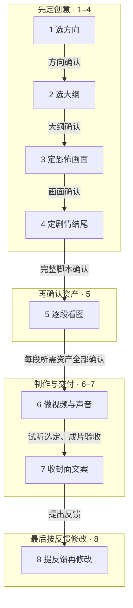
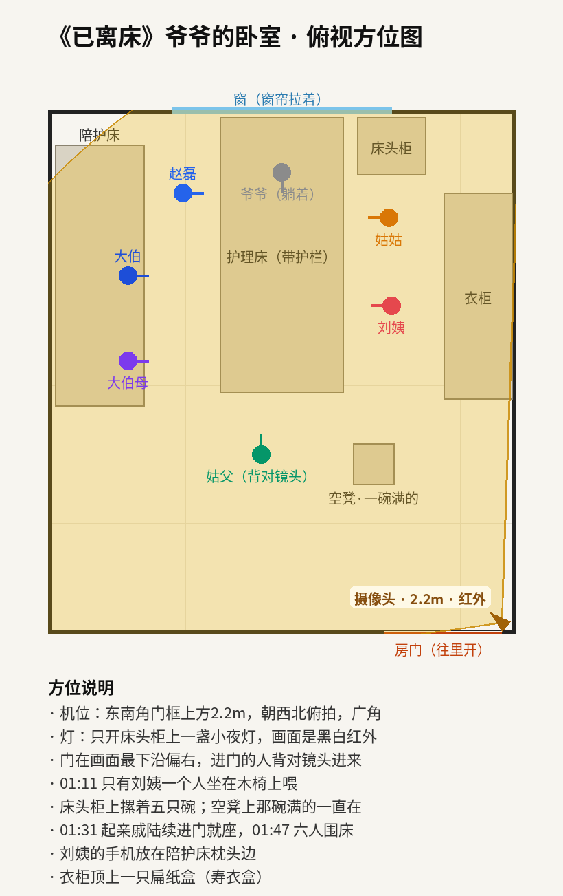
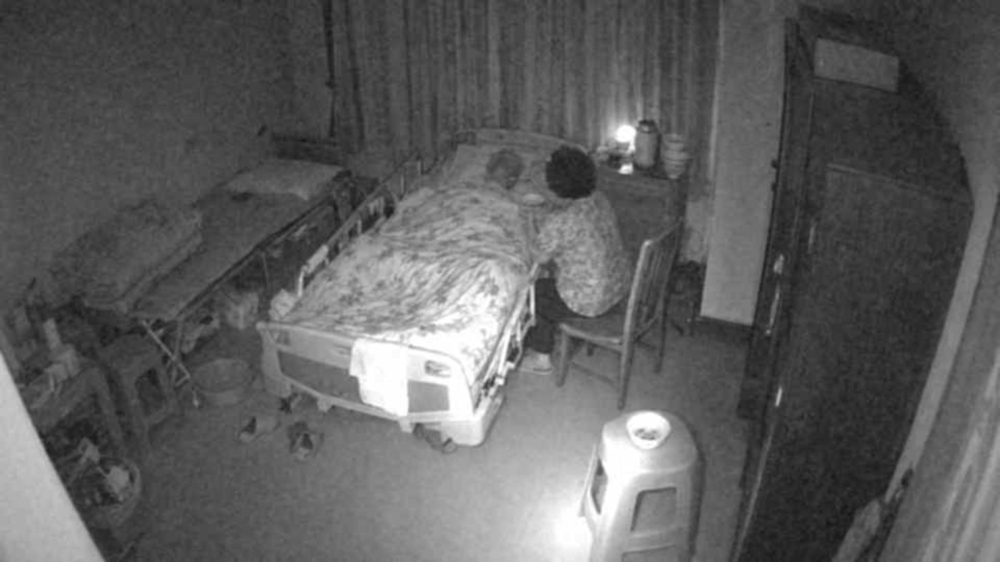

# 模拟恐怖：跟着 Manus 做一支手机录屏恐怖短片

作者 **wendy** · Skill **moni-kongbu** · 版本 **v1.2.0**

**[开始使用](./docs/MANUS.md) · [下载 Skill](https://github.com/wendy-skill-lab/moni-kongbu/releases/latest/download/moni-kongbu.skill) · [执行入口](./SKILL.md)**

你只需要说出一个让你发毛的场景，或直接说“我还没想好”。Manus 会先给方向，让你挑，再一起定最恐怖的画面、剧情和素材，最后做成像 iPhone 手机录屏一样的 9:16 原创短片：聊天中穿插监控、照片或设备记录，观众和主角一起发现哪里不对。

不需要先会写脚本，也不用一口气想好全部内容。它会分阶段提问，**你确认一层，才继续下一层**；只想聊方向或写脚本，也可以停在那里。

## 三步开始

1. [下载完整的 `moni-kongbu.skill`](https://github.com/wendy-skill-lab/moni-kongbu/releases/latest/download/moni-kongbu.skill)，不要只下载 `SKILL.md`。
2. 在 Manus 的「技能 → 添加 → 上传技能」中导入；也可从 GitHub 导入本仓库：`https://github.com/wendy-skill-lab/moni-kongbu`。已有同名版本，先备份再决定替换。
3. 在聊天里输入 `/`，选中 **moni-kongbu**，再发你的需求。添加 Skill 和开始创作是两件事。

可以直接复制这段开场：

```text
我刚添加了 moni-kongbu，想开始做一期模拟恐怖短片，还没定方向。
先问我最怕什么，给我配好对的场景和恐怖元素；我确认脚本后再做素材，每段资产全部确认后才做视频。
```

已有内容就说：“我已经有确认过的脚本，先接着定资产，不用重新选题。”把脚本附上即可。更多安装与接续方法见[使用教程](./docs/MANUS.md)。

## 八步：每次只决定一件事



### 1. 选一个让你发毛的方向

它先问“你觉得最恐怖的是什么？”，同时给约 6 对配好的“场景 × 元素”，再把选中的方向整理成场景卡。你可以挑一个、让它再来一批，或说“你定”；方向确认后才继续。

### 2. 选恐怖要素和大纲

它通常给 3 个方案，说明发生了什么、哪里不对，并给 5–7 行大纲。你选最有感觉的那份，或指出想加强的异常，确认方案和大纲。

### 3. 定下最恐怖的那一帧

它给具体的动作、机位、发现方式和回看线索，让你想象“观众到底看到什么”。你选最吓人的画面，也可以说哪里不够直观，认可后再展开剧情。

### 4. 把剧情和结尾补完整

你会收到分段脚本：屏幕上是什么、怎么操作、出现什么字和声音，以及 3–4 个结尾选项。你选结尾并确认整份脚本；**前四步只讨论和写文档，脚本未确认不生成素材。**

### 5. 一段段看图，确认资产

它先给方位图，再做界面帧、监控静帧等，并按段整理资产板。你检查机位、人数、位置、姿势、彩色或红外和首尾状态，明确说哪些通过、哪些要改；**待生成或待确认的格子不算通过，每段所需资产全部确认才做视频。**

### 6. 让画面动起来，试听并看成片

通过资产关卡后，你会收到由确认静帧制作的视频、关键声音试听和成片。你选声音、检查节奏与音画，完成验收；目标是 1080×1920、30 fps，发布版带 3.5 秒观看提示。

### 7. 收到封面与发布文案

完整制作任务中，成片会与 3:4 主封面、备选封面及发布文案同次交付，并附脚本、资产板和确认记录等。你检查标题、署名、虚构与 AI 说明；收到文案不等于已经替你发布。

### 8. 指出要改的地方

你可以按时间点说“这句太长”或“声音再轻一点”，它修改受影响部分并保留旧版。换场景、机位或人数要回第五步重新确认资产；剧情骨架改变则先回大纲与脚本，不跳过确认直接重做视频。

每一步更具体的“它问什么、我怎么答”，见[完整使用教程](./docs/MANUS.md)。

## 看一个实际选节案例：《已离床》

用户刚添加 Skill 想开始，先看配对方向，又让它再来几个，最后选了“瘫在床上的爷爷 × 住家阿姨”，确认场景卡。第二步选方案三：亲戚陆续进门，围床同步举勺，卧室画面与床垫状态相矛盾；随后定动作、机位和回看线索，第四步选了第一个结尾。

第五步先确认了方位图，之后收到 6 张监控母版候选和红外后期候选。**母版尚未最终确认，也没有进入视频制作；这里没有已完成的成片、封面或完整资产板。** 第六至第八步是后续会收到的内容。下面的回复是可照着说的示例，不是私聊逐字引用。

**先看方位：机位能不能拍到这段剧情？**



检查门、床、家具、六个人的位置和朝向，想象人物从门口进来时是否会被遮住。这一关确认的是空间安排，还不是确认全部素材。

可复制回复：“机位、六人的位置和家具可以，按这张方位图出母版，先不要生成视频。”

**再看母版：这张画面能不能作为后续制作的基础？**



对照方位图看床和家具是否一致，再检查阿姨坐姿、构图和红外质感；“看着够恐怖”不等于位置与剧情都正确。这是 AI 生成场景的后期候选，不是真实监控实拍。

可复制回复：“这张先保留为候选，人物位置和光线我还要再核对，先别生成视频。”

查看[六张母版候选](./docs/images/usage-master-options.jpg)和[完整选节案例教程](./docs/MANUS.md)。另有[资产板 · 教学演示](./docs/images/usage-asset-board-demo.png)：用上述原创图整理，不是原任务截图；部分格子待生成、状态待确认，**不能据此直接开拍**。

## 注意、许可与版本

这是独立、非官方的虚构创作项目，不连接真实微信或摄像头。案例剧情虚构，场景由 AI 生成；床垫读数是剧情设定，不是实际医疗产品原理。作品需保留虚构与适用的 AI 标识，不冒充真实事件或机构，不使用未经授权的肖像、声音、私密聊天。

Skill 不附赠模型服务或生成额度，实际能力与消耗以当前账号为准；缺少工具时停在能完成的阶段，不承诺固定成本或自动发布。模板是制作起点，不是完整原片素材包。

原创代码和文档采用 [MIT](./LICENSE)，须保留版权与许可通知；第三方资源依[独立例外与声明](./THIRD_PARTY_NOTICES.md)和[资源说明](./references/资源说明.md)处理，不能据此认定全部素材可商用。

版本仍为 **v1.2.0**，此次只更新图文教程，不新建版本、不改标签或 `.skill` 包。[版本记录](./CHANGELOG.md)。已添加 Skill 是否自动升级尚未验证，不把 GitHub 更新当作已同步；手动升级前先备份。

首页与 `docs/` 留在 GitHub 给人阅读，下载包提供 Agent 执行所需文件。需要本地安装命令或打包规则，再看[制作说明](./references/制作.md)与[发布约定](./docs/PUBLISHING.md)。
