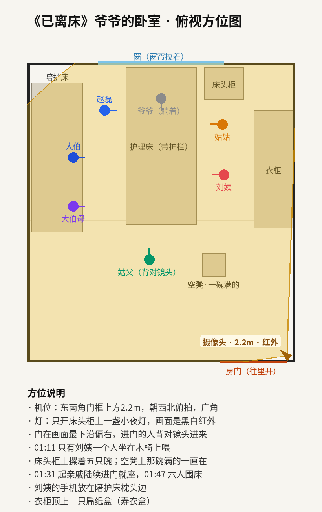
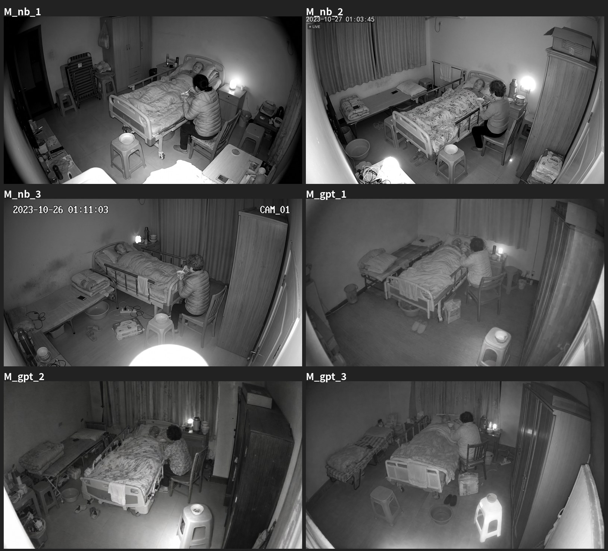
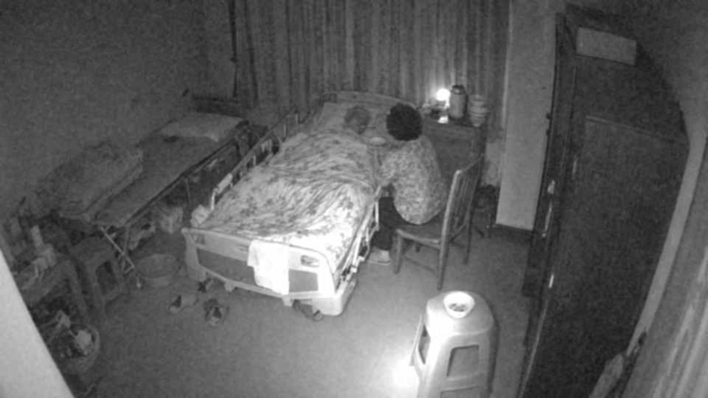
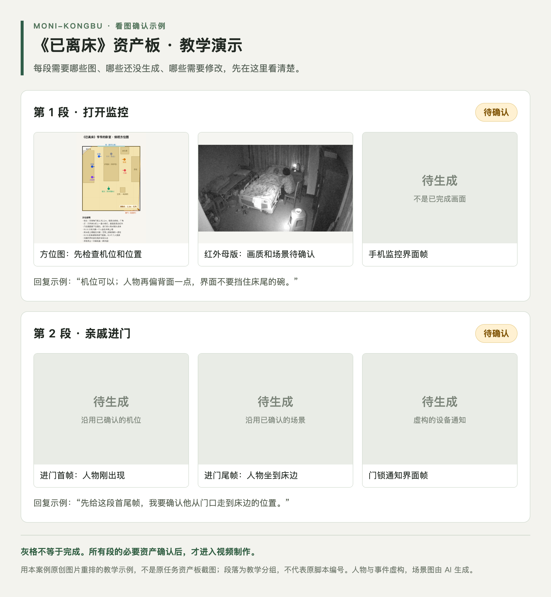

# 第一次用 moni-kongbu：你怎么回答，Manus 会给你什么

作者：wendy。

Skill 是给 Manus 用的一套分步方法，不是点一下就出片的按钮。还没添加？先[下载完整包](https://github.com/wendy-skill-lab/moni-kongbu/releases/latest/download/moni-kongbu.skill)，在 Manus「技能 → 添加 → 上传技能」导入。已添加后，在聊天输入 `/`，选中 **moni-kongbu**，再发送需求；只贴仓库链接不等于选中了它。

可以从一句话开始：

```text
我刚添加了 moni-kongbu，想开始做一期。还没想好方向，带我一步步来。
```

下面串起公开选节案例《已离床》：实际已完成方向、方案、视觉讨论与脚本确认，确认了方位图，收到了六张母版候选和红外后期候选，**母版尚未最终确认**。没有已完成的视频、完整资产板或封面。所有回复块都是**可以照着说的教学示例，不是原对话逐字引用**；第六至八步介绍后续会收到什么。

案例剧情虚构，场景由 AI 生成；床垫读数是剧情设定，不是实际医疗产品的工作原理。

## 1. 定方向：先说你怕什么

**它会问/给你**：先问“你觉得最恐怖的是什么？”，同时给约六对配好的“场景 × 元素”，告诉你是谁、隔着手机怎么看到、哪里不对。不需要你懂恐怖片术语。

**你可以这样回复**：任选一种，不必全部回答。

```text
我最怕熟悉的人突然做出不正常的动作。
再来几个方向，我还没选中。
我选“瘫在床上的爷爷 × 住家阿姨”。
都不想挑，你定一个，再给我确认。
```

**这一步你会看到/确认什么**：选中后会收到场景卡，写清人物关系、空间、设备和处境。《已离床》的用户先让它再给几个，再选了“爷爷 × 住家阿姨”，看过场景卡后回复 OK。你确认的是方向，不是整部片子。

## 2. 挖恐怖要素：挑一个方案和大纲

**它会问/给你**：通常给三个方案，说明发生什么、为什么吓人，并推荐一个，附上五至七行带时间的大纲。

**你可以这样回复**：

```text
选方案三：亲戚陆续进门，最后围床同步举勺。
保留卧室画面和床垫状态对不上的矛盾。按这个大纲继续。
```

**这一步你会看到/确认什么**：《已离床》实际选了第三个方案。你要看异常是否够具体、升级是否顺畅；不喜欢可以只改一处，也可以请它换方案。确认方案和大纲后，才细化最恐怖的画面。

## 3. 定视觉：恐怖点怎样出现在屏幕上

**它会问/给你**：约三种具体呈现，讨论机位、人物动作、怎么发现异常、设备字段写什么，以及第一遍和回看各能发现什么。**这里只讨论，不出图。**

**你可以这样回复**：

```text
我想隔着卧室监控看到六个人同时举勺，不切别人的视角。
先看到床上有人，再看到床垫状态矛盾。回看线索不要太抢眼。
请把机位、动作和屏幕上的字写清楚给我确认。
```

**这一步你会看到/确认什么**：一份可想象出“那一帧”的文字说明，而不是“气氛诡异”这种空话。案例实际在这里定了最恐怖画面、机位、动作和回看线索；你认可这幅画面，才继续写完整剧情。

## 4. 完善脚本：选结尾，确认每段怎么演

**它会问/给你**：补齐每段的时间、手机屏幕、打字、动作和声音，再给三至四个结尾，分别说最后的画面、声音、停在哪个事实、前面埋了什么伏笔。

**你可以这样回复**：

```text
结尾选第一个，不加解释。
请把每段屏幕内容、打字和声音整理成完整脚本。
我看过这一版了，脚本确认，可以开始定资产。
```

**这一步你会看到/确认什么**：《已离床》实际选择了第一个结尾。先读完整脚本，检查有没有不自然的台词或看不懂的转折；“选结尾”不等于所有脚本都确认。**前四步只讨论和写文档，脚本确认前不生成图片、视频或语音。**

## 5. 逐段定资产：看图，不急着让它动起来

**它会问/给你**：先方位图，再母版和后期候选，之后才是各段首尾静帧、关键画面、手机界面、头像照片与资产板。“母版”是后续画面沿用的基础静帧；“资产板”把每段要用的东西放在一起，方便逐项检查。

**先看方位图。** 它画的是俯视布局，不是成片镜头：机位高度和视野、门窗、床与家具、六个人站哪边、朝哪边。案例实际收到下图，询问机位、六人位置和家具，用户说可以。



*案例实际方位图。用于确认空间关系，不代表后面的生成图已经符合布局。*

看门能不能被拍到、床头床尾是否正确、人物会不会互相挡住、空凳和碗是否在视野里。要改就指明物件、方位和朝向，不必自己重画。

**你可以这样回复**：

```text
机位和家具位置可以，六人位置也确认。
```

若需要修改，可以说：

```text
把空凳移到床尾右侧，但不要挡住进门路线。
门口那个人保持背对镜头。先改方位图给我看，暂时不要出母版。
```

**再看六张母版候选。** 这是案例实际收到的六张 AI 生成候选，不是六张实拍截图，也没有哪张已获最终确认。



*实际生成候选。比较构图和设备质感，也要找错误。*

不要只选“最恐怖”的一张。先排除床方向或家具位置不符的；模型自行画出的时间戳、摄像头字样要去掉，后续按脚本准确叠加；鱼眼过强、像电影灯光的要调整；空凳上应一直有一碗满的，空碗或碗的位置错误都不能通过。这一段只有阿姨照料爷爷，后面六人围床需要另做对应状态，不能拿这张充数。

```text
先保留 M_gpt_2 作修改候选，还不算确认。
检查它和方位图是否一致；空凳上的碗要装满。
不要让模型自行画时间戳，鱼眼别太强。改后再给我看。
```

**然后看后期候选。** 案例也实际收到了这张红外后期图；它仍是候选，**不是实拍，也不是已确认的最终母版**。



*AI 生成场景的红外后期候选。案例尚未最终确认母版。*

核对机位有没有变，红外噪点和亮暗是否像普通卧室监控；人物、碗和回看线索是否保留。不是越糊越真实，也不能用后期遮住位置错误。

```text
这版先标待确认。机位不要变，检查人物和满碗是否清楚。
红外质感可以继续比较，但不要盖掉回看线索。母版确认后再做各段变体。
```

**最后逐段看资产板。** 下面是用上述原创图整理的“资产板 · 教学演示”，**不是原任务截图，也不是案例已经完成的资产板**。灰格标待生成，其他格也可能待确认，不能直接开视频。



*教学演示：展示怎么按段检查和回复，不能当作全部资产已齐的证明。*

**这一步你会看到/确认什么**：每段会写“这段要确认的是……”，例如群名和消息、视频首尾人数与姿势、设备读数、标志画面。按上方教学板的段号和格名，可以这样回复：

```text
第1段：方位图已确认；红外母版要改，人物再偏背面一点，改后重发。
手机监控界面帧仍待生成，别让界面遮住床和碗，这段还没全部通过。
第2段：进门首帧、尾帧和门锁通知帧都待生成。
先补齐，让我看清人物从门口走到床边的位置。
已确认项保留，其他项继续标待生成、待确认或要改。
```

每个“要改”都改图后再看，每个“待生成”都补齐后再确认。等实际看过所有段所需的全部资产，才说“所有段资产确认，可以进入视频”。**方位图确认不等于母版确认；母版确认也不等于全部资产确认。一句“继续”不能替灰格通关。** 第五步不生成视频、不配人声、不混音或渲染全片。

## 6. 制作与审片：先试听，再看片段和成片

**它会问/给你**：资产全部确认后，用确认静帧制作视频；关键声音会给三至五版试听，再放入时间轴。主角以打字为主，不给“我”配音。

**你可以这样回复**：

```text
声音选第2版，先给我同步举勺那段的试听片段。
我要检查动作是否同时、线索能否看清，再看完整成片。
```

**这一步你会看到/确认什么**：这是案例的后续阶段，不是已交付成果。审片时看人物和机位是否偏离确认图、文字能否读清、声音会不会盖住线索、节奏是否有发现异常的时间。完整制作验收后会收到 9:16 成片，包含 3.5 秒观看提示的发布版及无提示副本；无提示副本也不能冒充真实录像。

## 7. 封面与文案：收齐发布材料

**它会问/给你**：后续会用已确认的标志画面做 3:4 主封面和备选，连同成片交付文案、标签和置顶评论建议。

**你可以这样回复**：

```text
封面选第一版，标题别挡住关键动作。
文案署名用我提供的名字，保留剧情虚构与 AI 生成说明。
这次只交付文件，不代我发布。
```

**这一步你会看到/确认什么**：核对标题、线索时间点和制作来源。文案应如实说明“剧情虚构，含 AI 生成场景”；只有确实符合制作过程才写“全程由 Manus 制作”。文案中的声明不能代替平台要求的 AI 标识，**交付发布材料不等于自动代发布**。

## 8. 按反馈修改：告诉它哪一秒，改什么

**它会问/给你**：先区分细节和大框架，说明哪些部分受影响，保留旧版。

**你可以这样回复**：

```text
含观看提示的发布版 1:24–1:28，六人举勺这段动作太快。
把举起过程放慢一点，机位、人数和位置不变；先给修改片段。
保留旧版，不重做其他段。
```

**这一步你会看到/确认什么**：尽量说“时间 + 画面或动作 + 具体改动”，不要只说“不够吓人”。声音改动先试听；换场景、机位、人数或人物位置，要回第五步重定受影响资产；故事骨架变了，先回方案或脚本。时间点注明是正片还是含提示的发布版，两者相差 3.5 秒。

## 我只有某一步要做怎么办

说明已有内容和本次终点，已确认的阶段不用重来。

```text
只给我方向，选定前不写完整脚本，不生成素材。
```

```text
我上传的是确认脚本。请从方位图和逐段资产板开始，全部确认前不生成视频。
```

```text
我上传了成片，只改发布版 1:24–1:28 的声音，先试听，保留旧版。
```

生成依赖当前账号可用工具与额度，不保证免费、固定成本或耗时；缺工具时会停在能完成的内容。不读取真实聊天或连接摄像头，使用素材须有授权。原创代码与文档按 [MIT](../LICENSE)，第三方资源见[独立声明](../THIRD_PARTY_NOTICES.md)。已有同名 Skill 或要升级，先备份自己的版本；仓库、下载包与已添加实例不承诺自动同步。需要技术细节再看[制作说明](../references/制作.md)和[资源说明](../references/资源说明.md)。
